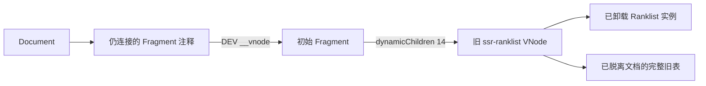

# RankLand 大榜单性能调查与优化方向

本文保留第一阶段调查基线。后续三项 P0 已在实际源码落实并完成 Mac/Windows 复测，见[实施与复测报告](p0-implementation-report.md)。

日期：2026-10-20。调查对象为用户反馈的 [2026 ICPC 网络预选赛第一场](https://rl.algoux.cn/collection/official?rankId=icpc2026preliminary-1)，以本仓库 `demo2.json` 和 Vue 组件为主。**本轮新增调研文档、证据及诊断脚本，未修改产品源码、依赖、线上服务或提交代码。** 实验优化全部在临时副本或隔离浏览器的响应拦截中运行。

## 结论

已复现明显卡顿，并找到多个独立的、已有因果对照的资源放大点。优先做基础优化有充分依据，不必把虚拟列表当作唯一出路。

1. **生产客户端实际打入 Vue 开发模式，且与首屏重挂载共同保留旧树。** `vite-ssr` 预解析配置把未设置的 `NODE_ENV` 写成 `development`；随后构建沿用它。仅 `--mode production` 无效，构建入口显式 `NODE_ENV=production` 的配置对照正确。小样本堆快照及完整榜单轻量探针已证实 DEV 的 DOM `__vnode` 属性保留旧 Fragment 与旧表。显式生产构建加稳定key的整页对照中，主heap降至约189 MiB、最长任务约425 ms，保持全量表格。
2. **RankLand 首屏 hydration 后强制更换 Ranklist key，重建全表。** 在全新 macOS Chromium 中，仅固定该 key，保持 2,535 行和 68,850 个页面元素，最长任务由约 2.14 s 降至 0.96 s，强制 GC 后主页面 JS heap 由约 580 MiB 降至 310 MiB。原版多保留约 198,820 个已脱离文档的节点；固定 key 后差额约 15 个。重复创建和旧表保留是实测事实，旧组件已卸载，但仍被开发态 DOM 调试属性强引用。
3. **后台排名曲线预计算存在算法与中间对象问题。** 逐行 `.find` membership 形成 O(N²) 成本，在逐分钟转换中反复执行；同时先累积各分钟的静态行，再二次提取点。独立真实函数对照中，修正查找并逐分钟提取结果，计算中位数从 4.53 s 降到 0.42 s，峰值 RSS 中位数从 369 MiB 降到 239 MiB，输出完整校验一致。
4. **纯组件全量渲染本身也很重。** 2,535 × 14 个状态格产生约 68,500 个元素、199,000 个全部类型 DOM 节点；原始数据模式的纯组件 GC 后 JS heap 约 169–170 MiB，另有 Blink/native 内存。6 倍 CPU 降速时，首次显示约 4.3 s，多种交互约 2–4.5 s。消除接入缺陷后，这个基础成本仍在。
5. **Windows VM 上真实页面正常负载已经出现 4.50 s 的单个主线程长任务。** 稳定态主 renderer 私有内存约 1.21 GiB。它足以解释用户感知的“页面像卡住”，但这轮正常加载没有崩溃，不能据此断言用户的整个浏览器卡死就是 OOM。

正常加载、长任务、受控资源限制、诊断工具导致的崩溃，必须分别记录。本轮全量 heap snapshot 导致测试 renderer 在采集阶段退出，这是高开销诊断引入的失败，**不是正常导航崩溃的复现**。

## 数据、环境与方法

### 数据与部署核实

`demo2.json` 与线上 HTML 内嵌的 SRK 解析结果完全一致：2,535 队、14 题、3 个榜列（其中 1 个 ICPC 排名列）、30,772 条提交、300 分钟。文件含格式化空白约 8.69 MB，紧凑 JSON 约 2.71 MB；线上 SSR HTML 解码后约 8.64 MB。这些都不等于网络压缩字节或内存占用。

线上公开 sourcemap 核实了实际部署的关键路径：Vue/core renderer 0.7.1、styles 0.7.0、utils 0.3.4，RankLand 相关源码与本地一致。具体 SHA、URL 与行号在 [接入路径专题](rankland-integration.md)。组件源码工作区 HEAD 为 `33df73f0b9ddf60e6622ceea06ab2500a2ce5619`；原有 demo 与 CCPC26 文档未改动。

### 测试环境

| 环境 | 用途与限制 |
| --- | --- |
| Mac15,8，128 GiB RAM，Chrome for Testing 151.0.7922.34 arm64 | 主机独立进程、全新 profile/context；1440 × 900、DPR 1；纯组件测试为production；线上原版实际包含DEV |
| 组件 Vue 3.5.33，Vite 4.5.14 | Vue/source来自本仓库；复用 sibling 的构建工具，不改项目依赖。旧 Vite2 的临时 semver 打包错误样本已作废 |
| 线上 Vue 3.5.35 | 直接加载真实 URL；单变量响应拦截只影响该次测试浏览器 |
| Windows 11 ARM64 build 26100，2 vCPU / 6 GiB，Edge 154.0.4258.37 | 真实用户提供的 VM；ARM64 原生 Edge，仍共享较快的 Apple Silicon 宿主，不能等同旧 x86 电脑 |
| CPU rate=6 | CDP 降速；没有同时限制 RAM/GPU，不称为真实低内存 |

没有 Browser 插件，采用已安装的 Playwright + CDP；Windows 通过 Parallels 与 guest PowerShell WebSocket 调用 CDP。测试 HTTP/CDP 仅监听 loopback，未开放局域网端口。已有用户浏览器不作为测试对象。

### 指标定义

- `firstFrame`：测试入口挂载后跨两次 `requestAnimationFrame` 的时间点，起点为 navigation；**不是 LCP 或 INP**。
- `mount` 包含该次同步数据转换和 Vue 挂载；转换另计，用于拆分成本。
- Long Tasks 为 observer 记录的主线程任务；以 >1 s 作为本次严重阻塞判据，50 ms 仍是标准 long task 边界。
- 元素数由 `querySelectorAll('*')` 计数；connected 全节点数由 TreeWalker 逐节点类型统计；CDP nodes 还可能包含 detached 节点。三者不混用。
- JS heap、embedder heap、renderer RSS、Windows private bytes/working set/系统 commit 是不同口径，**不能直接相加称为总内存**。GC 前后单点也不是连续峰值。
- 浏览器对照顺序执行；Node 算法对照每方案 3 个全新进程。除明确标中位数外，其余为单次观察；网络时间不用于评价脚本优化收益。
- 100/500 行测试仍先下载并解析完整 demo2，再裁剪；它证明渲染规模成本，不是已实现虚拟列表后的整体性能。

## 实测一：纯 Vue 组件

| 模式 | 行数 | 转换 ms | mount ms | 首帧 ms | 最长加载任务 ms | GC 后 JS heap MiB |
| --- | ---: | ---: | ---: | ---: | ---: | ---: |
| raw/shallow，正常 CPU | 100 | 0.7 | 27 | 128 | 无 ≥50ms 任务 | 10.9 |
| raw/shallow，正常 CPU | 500 | 2.8 | 85 | 231 | 98 | 40.2 |
| raw/shallow，正常 CPU | 2,535 | 40.5 | 354 | 690 | 368 | 170.2 |
| raw/shallow，6× slowdown | 2,535 | 259 | 2,266 | 4,335 | 2,356 | 179.3* |
| deep ref，正常 CPU | 2,535 | 1,052 | 1,535 | 1,905 | 1,549 | 220.3* |
| deep ref，6× slowdown | 2,535 | 9,947 | 13,403 | 15,418 | 13,492 | 220.3* |

`*` 这些运行在随后切换 preset、筛选和 remount 后才 GC，不能把最后一列当作完全相同显示状态下的内存差值。

6× raw 模式中的更新至两帧后时间：替换顶层数据 2.16 s，classic→compact 3.33 s，筛选至 100 行 0.64 s，恢复全量 4.19 s，重挂载 4.52 s。deep 模式顶层替换达到 18.56 s。它们是受控触发的更新阻塞，不是线上每个操作都会执行同一流程。

**不要误判 RankLand 为 deep-ref 问题。** 接入代码已使用 shallowRef/toRaw；Router state 和 props 也是浅层容器。deep 对照说明组件消费建议和高风险使用方式，不能替代线上根因证据。

生产 trace 中首次 `Layout` 约 149 ms、`UpdateLayoutTree` 约 49 ms；初次 JS/DOM 建立最长任务约 392 ms。CPU samples 指向 utils 的行查找、Vue 的 props/响应式/实例建立及 DOM 插入。JS、布局与对象分配都参与成本，JSON 解析约 13 ms 并非主因。trace 末尾包含人为 GC；其 GC 总时长不能用于宣称自然运行存在 GC 风暴。

滚动 rAF 间隔在正常全表样本 p95 约 25 ms；经过多次更新的 6× 样本达到约 150–159 ms，并出现多次长任务。这是该自动化场景的回调节奏，不等同显示器真实 FPS。没有获得有效 layer-tree 事件，本轮不宣称存在图层爆炸或 GPU 内存根因。 同显示状态、同为无trace的6×对照中，全局禁用backdrop-filter/transition/animation后，首帧4.16→4.30 s、滚动rAF p95 40.9→40.7 ms；没有显示出实质改善。因此不能把模糊/动画列为这份数据的主要根因。

### 保持全量表格的组件内部实验

每种方案3次、独立Chromium进程、交错顺序运行。均保留2,535行和68,527元素；全表文字SHA一致，首屏截图逐像素一致，队伍与提交点击返回相同ID和提交数量。

| 单变量实验 | mount中位数 ms | 首帧中位数 ms | GC后JS heap中位数 MiB |
| --- | ---: | ---: | ---: |
| 原始组件 | 346.5 | 664.9 | 170.8 |
| StatusBody共享组件类型 | 336.7 | 662.4 | 160.5 |
| 无custom slot时跳过slot参数构造 | 325.5 | 674.6 | 170.8 |
| 点击时才倒序solutions | 346.2 | 669.2 | 169.8 |
| 将StatusBody内容内联到StatusCell | 321.3 | 645.2 | 149.2 |

这些收益是真实但有限的。共享类型约减少10 MiB存活heap；内联减少约21.5 MiB（12.6%），但不会消除全表大DOM。lazy-slot-props的mount较快却没有改善首帧或存活heap；lazy-solutions在本数据几乎没有可辨认的首帧收益，不应列为最高优先级或承诺大幅提速。

inline变体少13,081个子组件，但Vue模板产生26,162个额外空文本Fragment锚点，CDP nodes反而增加；元素、可见内容和截图不变。这再次说明不能单凭node总数评价全部内存。该原型仍需检查其它preset、score、CCPC26、动态更新、SSR和slots。lazy-slot-props的共享空对象实验仅针对普通Vue消费，custom element路径需另行兼容，不能原样发布。

## 实测二：真实 RankLand 的单变量对照

全部使用同一 URL 和真实 2,535 行，1440 × 900，等待初始化后采样，强制 GC，再读 DOM/heap。每次独立浏览器。各真实页样本均为初访，包含同一显示样式提示弹窗；它是产品提示而非框架错误遮罩。

| 方案 | 最长主线程任务 ms | GC 后主页面 heap MiB | GC 后 CDP nodes | connected 全节点 | renderer RSS 采样峰值 MiB |
| --- | ---: | ---: | ---: | ---: | ---: |
| 原始页面，第 1 次 | 2,191 | 580.0 | 398,319 | 未计 | 1,699 |
| 原始页面，复测 | 2,142 | 580.3 | 398,319 | 199,499 | 1,683 |
| 只固定 Ranklist key | 958 | 310.0 | 199,514 | 199,499 | 1,196 |
| 只令曲线 Worker 接收后不计算 | 2,135 | 580.3 | 398,319 | 199,499 | 1,524 |

固定 key 的拦截只替换唯一表达式 `key:Ce.value?"client-ranklist":"ssr-ranklist"` 为 `key:"client-ranklist"`，不跳过 readiness、显示设置或页面 reveal。它是实验补丁，尚非发布修复；需要真实 SSR/偏好/主题/语言/回放回归。

原版 detached 差额为 198,820，而纯组件全表节点数为 198,819，结合稳定 key 对照，有力支持旧表在重建后被保留。两种模式元素数完全相同，但文本/注释锚点分布不同（hydration 与客户端 mount 的表示不同），所以不能仅凭元素数或一张截图发现该问题。

这证明一次首屏存在不必要保留；**尚未证明连续导航会无限累积**。100行SSR副本的堆快照已补齐最底层引用链；多次进出后的增长仍应作为修复验收的一部分。全量堆快照尝试使诊断过程 RSS 增至约 11.3 GiB 后 renderer 退出，快照未生成；该运行不进入上表或正常崩溃结论。

空 Worker 对照保留 Worker 创建、消息克隆与主线程准备，只禁止 Worker 内计算，所以它不是“完全关闭预热”的严格实现。它表明曲线计算不能解释旧表节点和主页面约 580 MiB heap，但影响进程整体峰值和 CPU；Worker 有自己的 isolate，不能拿主 target heap 代表 Worker 内存。

### 开发模式如何保留旧树

已确认的调用顺序：`vite-ssr@0.17.2` 先调用 `vite.resolveConfig(..., 'build', mode)`，省略第四个 `defaultNodeEnv`；Vite 4.5.14 默认值为 `development`，在配置读取前填入 `process.env.NODE_ENV`。随后 `vite.build` 不覆写已设置值，而 RankLand `vite.config.js:44` 又优先使用它。项目 `build:client` 与CI构建入口未显式设定生产环境。线上主JS包含无条件 `__VUE_HMR_RUNTIME__` 初始化和完整DEV分支，不只是开启 production devtools。

三组只读配置对照确认：未设NODE_ENV → DEV；仅mode=production → 仍DEV；入口NODE_ENV=production → production/isProduction=true。运行服务时设置 `NODE_ENV=production` 不能回头修复已经打包的浏览器JS。

100行SSR副本保留生产版本与SSR fragment标记。堆快照过滤 weak、console 和WeakMap合成路径后找到：



旧实例 `isMounted=true` 且 `isUnmounted=true`，说明卸载已发生。Vue DEV hydration 给Fragment anchor写入`__vnode`，后续Fragment复用anchor更新子树时该调试引用仍指向初始block。不是“忘了unmount”，也没有证据归因HMR Map或Devtools事件buffer。完整2,535行页面的轻量DOM探针也确认相同链：连接中的注释引用已卸载旧VNode，旧根已脱离document而仍含2,535行；`hookReplay=null`，排除事件buffer未清空的解释。见[完整榜单引用证据](evidence/full-page-retainer.json)。完整版本/源码行号与快照对象链见[专题第6节](rankland-integration.md)。

优先修复构建环境，避免把删除DEV属性当作应用层补丁；然后去掉非必要key重建。已完成显式production的完整客户端构建对照（[构建与SSR适配说明](production-build-experiment.md)）：仅把公开资源映射到临时构建，原SSR body和全部inline state字节未变，公共client env匹配。当前SSR没有scope属性；新旧scoped CSS唯一差异已核实，首屏截图逐像素相同，没有借助样式丢失减轻页面。

| 整页构建与key组合 | 最长任务 ms | GC后主heap MiB | GC后CDP nodes | renderer采样RSS峰值 MiB |
| --- | ---: | ---: | ---: | ---: |
| 线上DEV + 原key | 2,142 | 580.3 | 398,319 | 1,683 |
| 线上DEV + 稳定key | 958 | 310.0 | 199,514 | 1,196 |
| 显式production + 原key | 1,059 | 191.6 | 199,511 | 1,360 |
| 显式production + 稳定key | 425 | 189.0 | 199,510 | 1,013 |

两组production运行的`__VUE_HMR_RUNTIME__`和DOM `__vnode`均不存在，旧Fragment retainer探针为空。原key的production样本GC前仍约398k nodes，说明重复分配依旧发生，但旧树随后可回收；稳定key则避免这轮分配和额外任务。

这是同机受控诊断，production资源由本机拦截提供，下载/TTFB不同，因此不把导航总时长用于收益比较；表中任务和内存是观察值，不是面向所有设备的SLO承诺。尚未发布，也未在Windows重复运行production对照。另一轮完整交互复测的最长任务为原版2,130 ms、production+稳定key424 ms，后者heap仍约189 MiB；两版全表文字SHA完全一致。关闭初访提示、点击第一队并等待排名曲线，两者均成功显示同一队伍成员和图表（准备已完成后的约160 ms，非冷启动曲线成本）。

基础UI核验：页面URL/标题正确、2,535行完整、无框架错误覆盖层、无pageerror；原版与production首屏截图逐像素一致。纯组件各变体的队伍/提交点击也通过。临时静态服务控制台的404为缺少favicon，不属于框架异常。未完成全SRK合约、所有显示选项、移动端、低配x86/GPU设备或生产Windows对照，实验结果不能直接当作发布验收。

## 实测三：排名曲线算法

首次 mounted 后会调度全员曲线预计算，即使用户尚未点开队伍详情。300 分钟生成 301 个时间点，本数据有 298 个分钟桶含新提交，共产生 299 份不同 staticRows 数组、757,965 个静态行外壳和 763,035 个最终 point。

`convertToStaticRanklist` 的 ICPC callback 中，每行用 `filteredRows.find` 确认 membership；对本数据每次约 321 万次 ID 比较、299 次约 9.61 亿次。此数字是源码/数据推导，不是 profiler 硬件指令计数。曲线保留的是浅 row/rankValues 及变化状态，不是 300 份完整 JSON 深拷贝。

| 真实函数的临时变体 | 3 次运行耗时中位数 | 最大 RSS 中位数 | GC 后 heap 中位数 |
| --- | ---: | ---: | ---: |
| 原始 | 4,530 ms | 369.3 MiB | 64.0 MiB |
| 仅 membership 改 Set | 506 ms | 372.3 MiB | 64.4 MiB |
| Set + 每分钟直接收集 points | 419 ms | 239.4 MiB | 64.4 MiB |

三方案完整 Map/结果序列化的 SHA-256 相同。计算耗时降低约 90.8%，进程峰值 RSS 降低约 35.2%；最终结果缓存仍然存在，不能把临时内存优化说成最终缓存归零。测试为 Node 独立函数，不能将 4.53 s 直接视作主线程阻塞；当前正常路径运行在 Worker。

## 实测四：Windows 与系统压力

Windows 正常负载、环境与原始证据见 [Windows 专题](windows-environment.md)。纯组件全表首帧 1.56 s、连续 688/711 ms 长任务、GC 后 JS heap 168 MiB，renderer working set 550 MiB。真实页面初始稳定样本单任务 4.50 s，GC 后主 heap 578 MiB、private bytes 1,238 MiB；未发生自然加载崩溃。

SSR 的 2,535 行出现与 document complete 不代表 hydration 完成：本次实际大任务发生在 SSR ready 之后。首个提前采样被明确排除，不能以它较小的 long task 值宣称网页流畅。

全新单target正常复测最长任务4.398 s，与初始样本一致。再加入最多1 GiB实际触页内存和一个逻辑CPU的受控负载：最长任务4.200 s，并没有证明额外变慢；加载期间系统commit达到90.24%，可用物理内存最低约391 MiB，保护进程在约260 ms内释放压力。未发生自然浏览器崩溃，也未继续加压追求OOM。

这说明本页在6 GiB系统及已有工作负载下可以显著压缩余量；同时该试验不能证明换页风暴或将“1 GiB压力”外推成所有低配机器的表现。GC后的稳定样本是在压力解除后取得，不能称作持续低内存稳态。Windows测试进程与guest HTTP/CDP监听已全部清理，原有用户浏览器及VM状态未改动。

## Chromium 与系统机制如何解释这些现象

详细源码、官方文档及边界见 [Chromium/V8/Windows 机制专题](chromium-mechanisms.md)。

- Chromium 的主线程需执行 JS、样式和布局；秒级任务即使没有 OOM，也会推迟输入和绘制。桌面 input ACK 的源码有 unresponsive 检测路径，但不能把某个默认超时当作所有浏览器/加载都必然弹窗的阈值。[长任务](https://web.dev/articles/optimize-long-tasks)、[Chromium input ACK](https://chromium.googlesource.com/chromium/src/+/refs/heads/main/content/browser/renderer_host/render_widget_host_impl.cc)
- V8 heap 不是页面全部内存。DOM/layout/native、GPU、Worker、原始 SSR 状态也占资源；低压力下 GC 可以晚些执行，高压力通知可能以更多暂停换取回收。不能因为 heap 低于上限就排除进程/系统资源问题。[Chrome 内存诊断](https://developer.chrome.com/docs/devtools/memory-problems)、[V8 pressure API](https://chromium.googlesource.com/v8/v8/+/refs/heads/main/include/v8-isolate.h)
- Windows 物理可用量、working set 与 commit limit 不同。工作集回收、硬缺页和磁盘等待会放大延迟；commit 接近上限可能造成冻结/分配失败。要同时采样，不把单次 page fault 当作磁盘换页证据。[Microsoft pagefile](https://learn.microsoft.com/en-us/troubleshoot/windows-client/performance/introduction-to-the-page-file)
- CPU throttling 不模拟 RAM、GPU、磁盘；`Memory.simulatePressureNotification` 只发送通知，也不创建 RAM 上限。保护策略如 tab discard 不是前台页面的性能保障，不能代替应用减少分配。

因此，“Mac 常常看不出来、低配置或高负载用户卡住”在机制与本次实测上相容。但没有用户现场的 crash reason/commit/trace，仍不能把偶发**整个浏览器卡死**归为唯一的 OOM、GPU 或浏览器缺陷。

## 基础优化：保留全量表格

| 优先级 | 方向 | 已有证据、收益范围与验收重点 |
| --- | --- | --- |
| P0 | 构建入口显式使用 NODE_ENV=production，并审计最终bundle | 已确认线上DEV与配置污染链；仅mode不够。检查runtime全局/DEV代码消除、SSR hydration、客户端与服务端环境一致；不只检查压缩文件大小 |
| P0 | 取消首屏无条件 key 重挂载，修复旧表保留 | DEV对照显著降低主线程任务与GC后内存；修正production后主要减少重复分配和任务，收益不能叠加计算。保持 SSR、偏好应用、主题/语言、hydration遮罩、事件和生命周期；检查 detached 节点及多次导航 |
| P0 | utils ICPC membership 建 Set/索引 | 曲线函数计算耗时约降至1/9；属于 utils 库。覆盖不同series、official、markers、并列排名和边界ID，不能只验demo2 |
| P0 | 曲线按时间点提取结果，释放历史中间行 | 临时 RSS 峰值降低约35%；保留point顺序、分段、AC/FB事件、冻结/回放语义 |
| P1 | 曲线按需启动、缓存与取消；减少重复消息克隆 | 首屏自动计算已确认。按需不意味着把同步计算转嫁给点击；继续用Worker，展示loading并支持切换/卸载取消。只用requestIdleCallback延后不减少总工作 |
| P1 | 减少每格组件类型与无用计算 | `StatusBody` 在每个StatusCell setup内重新defineComponent；默认无slot时仍构建slot props/closure/reverse arrays；可点击判定不需要预先倒序提交。三轮单变量结果见纯组件实验小节，收益有限，低于构建模式与曲线算法修复 |
| P1 | 控制更新传播，保持静态数据浅层存储 | RankLand已有shallowRef，无需盲目重写。上游替换需保持row/props稳定；度量preset、过滤、回放的更新范围，避免缓存失效导致全表重算 |
| P2 | 精简主线程初始化和重复状态保留 | schema/diagnostics、clone与原始SSR状态需要独立计量及生命周期管理。不能直接删除必要校验或共享初始state |
| P2 | 绘制特效降级、分批挂载、受控表格宽度 | 仅在paint/layout对照支持时采用。分批挂载改善最长任务但不降低最终内存；固定列宽要检验长队名、语言、响应式，不能用任意像素裁剪替代 |

纯组件空状态格有 22,409 个，占 63.1%；直接渲染 `<td>` 可少建同量 StatusCell，但判断上移可能让父表订阅所有 status.result，反而放大全表更新。需明确不可变快照/深层修改契约，必要时按行隔离，保留 custom slot 与空→AC/回放倒退的行为。不能仅按实例数减少就直接发布。

不推荐把 `content-visibility:auto` 机械加到每个 `tr`：原生表格内部盒子的 containment 有规范限制，且即便跳过部分绘制，也不会消除Vue实例与数据内存。也不应给每行加 `will-change`/`translateZ(0)`；图层与纹理有额外成本。

## 进阶优化：改变渲染或数据结构

1. **行虚拟化是主要方向。** 保留完整计算数据，仅挂载视口及少量overscan的行；14题暂不必先做列虚拟化。100行实验证明该数量级的组件/DOM可以小很多，但它不是可直接承诺的虚拟列表最终首帧。
2. **先设计行为契约。** 全表auto列宽不能依赖未挂载行；要设计colgroup/测量与缓存，固定表头/横向滚动、可变行高与跳转定位。筛选/排序/回放要保持user.id稳定和滚动锚点；列变化/CCPC26揭示需对齐。
3. **补齐全表能力。** 浏览器查找、全选复制、打印、导出、可访问性和SEO会受虚拟化影响。提供独立搜索/定位、明确的全量导出/打印路径，以及合理的行数与aria元数据；不能在交互上静默丢失功能。
4. **排名曲线和数据传输独立改造。** 全员points可用紧凑数组/稀疏变化点/服务端缓存；仅请求单队时仍需要全体参与者排名计算，不能误称为只计算一队即可正确排名。提交明细按需加载涉及接口和回放能力，是另一项设计工作。
5. **SSR策略单独权衡。** 首屏/摘要SSR加客户端虚拟窗口可减少HTML和hydration；需决定索引、分享落点和非JS浏览能力。不能同时保留隐藏的完整SSR树来实现“虚拟化”，否则内存收益消失。

建议顺序：先纠正生产构建，再消除重挂载/保留与曲线算法放大器 → 测量剩余首屏、交互及内存 → 再实施行虚拟化。否则即使虚拟化，后台曲线和重复状态开销仍会留存。

## 后续修复的验收

- 生产构建、同一demo2和小样本，Mac正常/6× CPU与Windows正常/受控压力，至少多次独立运行并报告中位数与最差值。
- 初始SSR、hydration、偏好应用、首次可交互分开打点；量化最长任务与触发操作，避免仅看DOMContentLoaded或网络完成。
- 同一显示状态下比较GC前后heap、connected/CDP nodes、进程peak；连续进入/退出/换榜至少10轮，验证旧表与Worker可释放，内存不随次数阶梯增长。
- 真实点击队伍/提交、按学校/官方/marker筛选、清除筛选、修改preset/主题/语言、回放前进后退、CCPC26边界、弹窗关闭与销毁。
- 排名/事件输出语义校验与UI行为都通过再推广；本轮临时副本的单样本等价不替代合约测试。
- 若用户仍报告整个浏览器卡死，补齐其浏览器版本/架构、OS与显卡、任务管理器的commit/进程private、页面trace或crash ID；不能把未捕获的现场原因写成已确定。

## 证据与复跑入口

- [RankLand 路径与算法实验](rankland-integration.md)
- [显式production构建对照及SSR一致性](production-build-experiment.md)
- [Chromium/V8/Windows 一手资料](chromium-mechanisms.md)
- [Windows 环境、测量与清理](windows-environment.md)
- [浏览器原始指标汇总](evidence/browser-experiments.json)、[组件三轮中位数](evidence/component-variant-medians.json)、[曲线算法九轮数据](evidence/rank-time-benchmarks.json)
- [计划](task_plan.md)、[过程记录](progress.md)、[调查笔记](findings.md)
- 临时脚本/production构建/截图/trace：`/private/tmp/srk-performance-20261020/`；Windows脚本：`/private/tmp/srk-windows-tools/`。

代表命令：

```sh
node /tmp/srk-performance-20261020/build.mjs
# 静态服务仅监听127.0.0.1，浏览器运行时已安装，无需改项目依赖
python3 -m http.server 4178 --bind 127.0.0.1 --directory /private/tmp/srk-performance-20261020/dist
node /tmp/srk-performance-20261020/run.mjs name=raw-cpu6 cpu=6
node /tmp/srk-performance-20261020/online.mjs name=original
node /tmp/srk-performance-20261020/online.mjs name=stable-key stableKey=1
```

脚本内绝对路径绑定本机工作区；临时资源不是稳定发布工具，复跑前检查版本、目标文件和数据SHA。没有修改现有产品流程，也没有创建自动化或持续监控任务。
